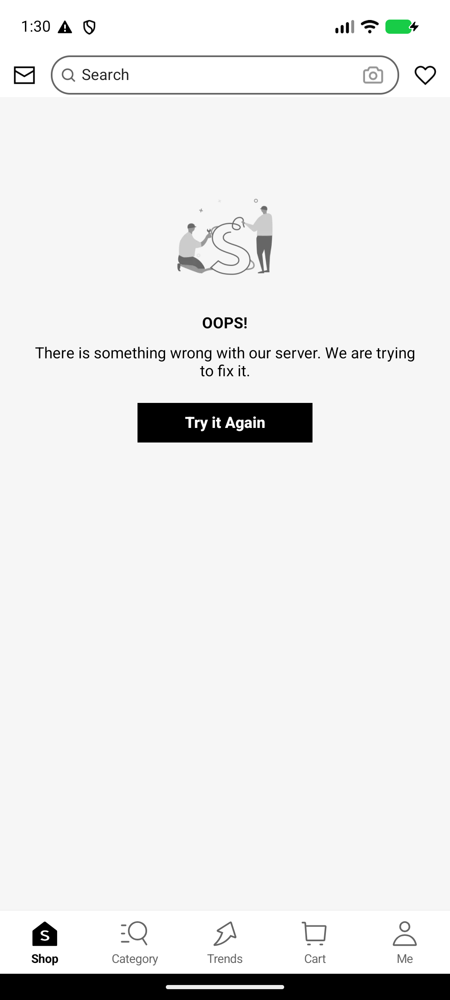
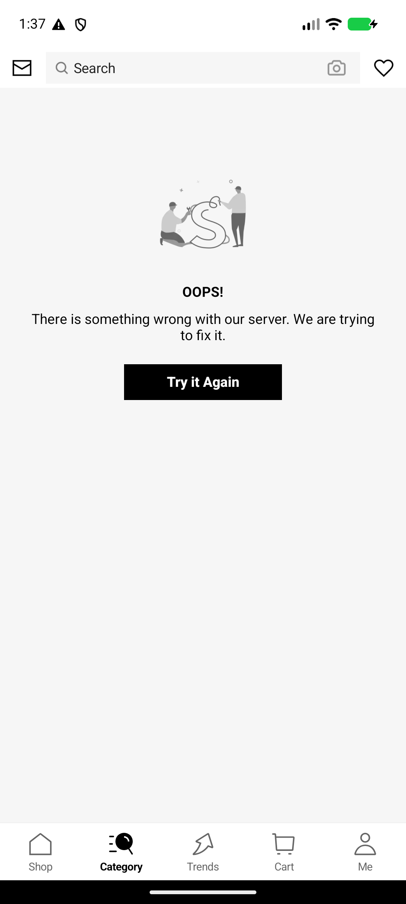
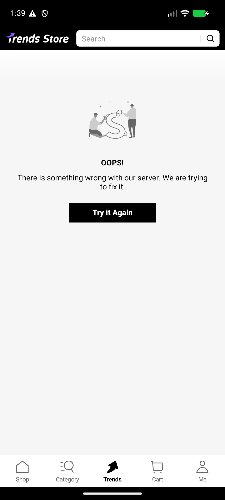
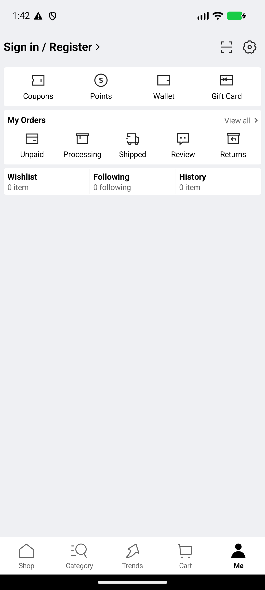
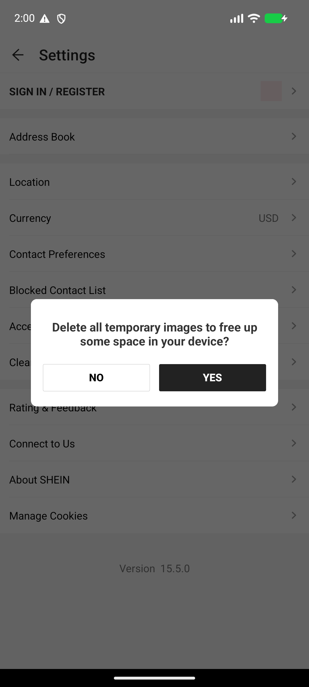
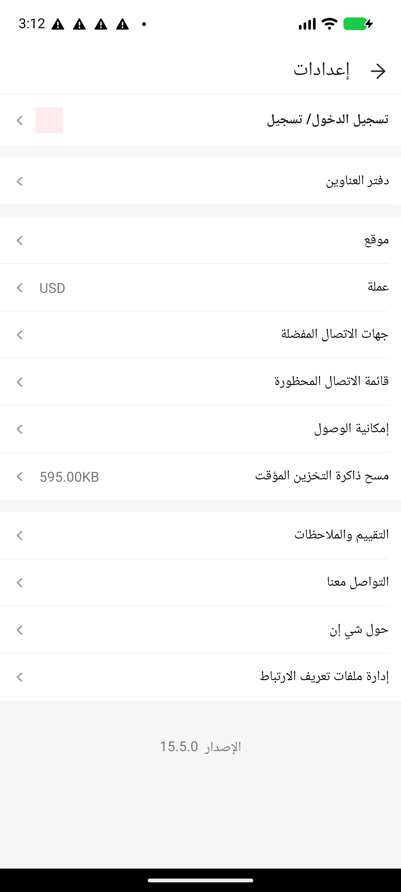

# SHEIN 15.5.0 — دراسة UI/UX وتحليل نظام التصميم

> أرشيف تحليلي مغلق. هذه الدراسة تسجل ما لوحظ فعلياً في بناء التطبيق ولقطات الشاشة، وليست خطة تنفيذ معتمدة ولا عقداً لنظام تصميم.

| البند | القيمة |
|---|---|
| التطبيق | SHEIN — `com.zzkko` |
| الإصدار | `15.5.0` — versionCode `2941` |
| المنصة | Android — `minSdk 23` / `targetSdk 36` / `compileSdk 36` |
| نمط الواجهة | Native Android Views وXML — 3,721 ملف layout، لا Compose/React Native/Flutter |
| الجهاز | محاكي Pixel-class — 1,080×2,400 px — كثافة 420dpi — 2.625 px/dp |
| اللغة | الإنجليزية (LTR) والعربية (RTL) |
| تاريخ التحليل | 2026-10-23 |
| حالة الأرشيف | مسودة PR مغلقة، غير مدمجة |
| حجم الحزمة | APKM 45.98 MiB — base APK مستخرج (78.97 MiB) |
| SHA-256 للـAPKM | `D130C3A3436561E57F75C3160C011753FA5683FB375BA955D7542383265A2E0A` |
| SHA-256 للـbase APK | `C4AC56B8292D372661F016B91BD19B6136BF61E8D0C465C87EEC0B6A5F512D26` |

## 0. المنهجية ونطاق الأدلة

اعتمدت الدراسة على طبقتين:

1. **تحليل ساكن للحزمة:** فكّ الحزمة بـapktool 3.0.3، ثم قراءة `AndroidManifest.xml` و`apktool.yml` وموارد `res/values` و`res/font`، وإحصاء الـlayouts والـdrawables والـdimens والـstyles. شمل ذلك فحص `cmap` لملفات الخطوط للتأكد من تغطية الحروف العربية.
2. **التقاط حي على محاكي:** 30 لقطة شاشة بـ`adb exec-out screencap`، وأربعة تفريغات UI hierarchy (`uiautomator dump`) لشاشات تسجيل الدخول، وحسابي، والإعدادات، وحوار مسح التخزين المؤقت. القياسات بالـdp مشتقة من كثافة الجهاز 2.625.

**حدود النطاق:** لم يتضمن الاختبار تغذية المنتجات الحقيقية، ولا شاشات PDP/PLP الكاملة، ولا السلة الممتلئة، ولا الدفع، ولا حساب مسجل. حالات `OOPS!` سائدة لأن الاتصال بالخادم وخدمات Google Play كانا محجوبين في بيئة الاختبار. اللقطات تتضمن أيضاً حوارات ANR من النظام (`Pixel Launcher` و`System UI`)؛ هذه ضوضاء بيئة وليست عيوباً في SHEIN، واستُبعدت من الاستنتاجات.

**قاعدة الفصل:** كل ما هو مأخوذ من الموارد يوصف بأنه «قيمة مورد»؛ وكل ما هو مأخوذ من اللقطة يوصف بأنه «قيمة مرصودة». لا تُخلط القيمتان.

## 1. الخلاصة التنفيذية

SHEIN 15.5.0 يقدّم هيكلاً تجارياً واضحاً: خمسة تبويبات سفلية، ومركز حساب، وإعدادات متداخلة، وشاشة دخول بسيطة. الانعكاس إلى العربية في التنقل والرؤوس والأسهم جيد عموماً. لكن البناء الذي جرى اختباره يكشف ثلاث فجوات كبيرة:

- **فجوة المرونة:** خطأ الخادم يختزل التطبيق كله في شاشة `OOPS!` واحدة، بلا كشف اتصال، ولا محتوى مخبأ، ولا رمز خطأ، ولا مسار دعم. التبويبات الخمسة تظل قابلة للتبديل، لكن كل تبويب يعيد الشاشة نفسها.
- **فجوة الإكمال:** شاشة تسجيل الدخول تقبل البريد ثم لا تُظهر تحققاً ولا تحميلاً ولا خطأ عند الضغط على `Continue`؛ وشاشة `Change Currency` تظهر بيضاء تماماً؛ وشاشة البحث العربية تظهر بيضاء بلا سجل أو اقتراحات.
- **فجوة الاتساق:** الرأس وشريط البحث وخلفيات التبويبات وأشكال الأزرار تختلف بين الشاشات. الخط المحلي `Adieu` لاتيني فقط ولا يغطي العربية، فتعتمد العربية على خط النظام؛ وأحجام النص تهبط إلى 8–12sp، وأهداف اللمس تهبط إلى 21–36dp في عناصر متكررة.

**الأولوية:** إصلاح حالات الفشل والفراغ أولاً، ثم توحيد الهيكل البصري، ثم رفع الوصولية والمسافات، ثم معالجة التفاصيل اللغوية. لا تحتاج المشكلة إلى إعادة تصميم كاملة؛ تحتاج إلى طبقة حالات ونظام مكوّنات واضح.

### أهم عشر نتائج

| # | النتيجة | الشدة | الدليل |
|---|---|---|---|
| 1 | خطأ الخادم يحجب كل التبويبات ولا يقدم بديلاً عن `Try it Again` | P0 | s02/s04/s05/s12/s13/s14/s15/s27/s28/s33 |
| 2 | تسجيل الدخول لا يعطي أي استجابة مرئية بعد `Continue` | P0 | s17–s20 |
| 3 | شاشات بيضاء/سوداء بلا حالة فراغ أو تحميل (`Change Currency`, `Search`, GMS) | P0 | s24/s25/s26/s30/s34 |
| 4 | الرأس وشريط البحث يختلفان بين Shop وCategory وTrends | P1 | s12/s13/s14 |
| 5 | هدف لمس شعار الرجوع في الدخول 24dp، وأزرار الحوار 36dp | P1 | signin.xml / dialog.xml / s22 |
| 6 | خط `Adieu` لا يحتوي الحرف العربي `ا` (U+0627)، والعربية بخط النظام | P1 | font cmap / s28/s29/s32/s34 |
| 7 | نسخ عربية غير متسقة: «الاراء الكاملة»، «تعليق»، «0 متابع»، «حاولي مرة اخرى» | P1 | s29/s31/s32 |
| 8 | مربع وردي `#FFEBEE` بديلاً عن أيقونة الحساب في الإعدادات | P1 | s21/s32 |
| 9 | سطحان/خلفيتان مختلفتان لكل مجموعة شاشات، بلا طبقة Tokens دلالية | P2 | s12–s16/s21 |
| 10 | حوار المسح يستخدم `NO`/`YES` بدل فعل صريح، وزر الحذف غير متمايز بصرياً | P2 | s22/dialog.xml |

## 2. نظام التصميم

### 2.1 الألوان

الموارد تحتوي **1,648** لوناً. أكثر القيم تكراراً في `colors.xml` هي:

| القيمة | التكرار | ملاحظة |
|---|---:|---|
| `#000000` | 20 | نص أساسي وأزرار خطأ |
| `#FFFFFF` | 18 | أسطح وبطاقات |
| `#666666` | 13 | نص ثانوي |
| `#222222` | 10 | CTA في الدخول |
| `#E5E5E5` | 10 | فواصل وحدود |
| `#F93A00` | 10 | برتقالي العلامة |
| `#FA6338` | 10 | برتقالي فاتح |
| `#F6F6F6` | 9 | خلفية Shop/Category/Trends |
| `#959595` | 8 | نص ثالثي/معطل |
| `#1F000000` | 8 | أسود بشفافية |
| `#D62000` | 8 | أحمر العلامة |
| `#A63E00` | 7 | بني/برتقالي داكن |
| `#F82854` | 7 | وردي/أحمر |
| `#99000000` | 6 | Scrim |
| `#E6E6E6` | 6 | حدود فاتحة |

**الأسطح المرصودة فعلياً:**

| الشاشة | السطح | العينة |
|---|---|---|
| Shop / Category / Trends | `#F6F6F6` | s12: 25,180 بكسل؛ s13: 26,071؛ s14: 23,295 |
| Cart | `#FFFFFF` | s15: 28,425 |
| Me | `#EFF0F3` | s16: 20,923 |
| Settings / Auth | `#FFFFFF` | s19: 27,451؛ s21: 21,146 |
| Search | `#FFFFFF` | s34 |

**الألوان الدلالية المرصودة:**

| الدور | القيمة | الدليل |
|---|---|---|
| نص أساسي | `#000000` | s12–s16 |
| نص ثانوي | `#666666` | s12/s16/s21 |
| نص ثالثي/معطل | `#959595` | s12/s21 |
| CTA الدخول | `#222222` | s17/s19/s20 |
| CTA خطأ | `#000000` | s12/s28/s33 |
| رابط | `#2D68A8` | s17–s20 |
| Facebook | `#3949AB` | s17/s19 |
| فاصل | `#E5E5E5` | s17/s19 |
| Placeholder وردي | `#FFEBEE` | s21/s32 |
| أخضر الثقة | `#198055` | s17/s19/s20 |
| نجاح | `#007D49` | مورد |
| تحذير | `#A86104` | مورد |
| Night surface | `#111111` / `#1E1E1E` | `values-night/colors.xml` |

**ملاحظات:**

- لا توجد أسماء موارد دلالية قابلة للقراءة؛ أسماء الألوان في البناء المفكوك مستعارة (`APKTOOL_RENAMED_*`). هذا يجعل توحيد اللون عبر المكوّنات صعباً، لكنه لا يمنع وجود طبقة Tokens فعلية في المصدر.
- ألوان العلامة البرتقالية موجودة في الموارد لكنها لا تظهر في الشاشات الملتقطة؛ الشاشات التجارية الأساسية استخدامها أسود/رمادي. لا يمكن الجزم بأن هذا انحراف مقصود أم أن الواجهات الملتقطة كلها حالات فشل.
- `#959595` على `#F6F6F6` يعطي تبايناً **2.77:1**، أي أقل من الحد المطلوب 4.5:1 للنص العادي. `#666666` يعطي **5.31:1** ويمر.
- الوضع الليلي موجود على مستوى الموارد فقط؛ لم تُلتقط شاشات ليلية، ولا يمكن الحكم على اكتماله.

### 2.2 الخطوط والتسلسل الطباعي

**الخطوط المحلية:**

- `Adieu` بأربعة أوجه: Light / Regular / Bold / Black.
- تعريفات `font-family` تغطي أوزاناً أوسع (300، 370، 450، 500، 510، 550، 590، 600، 858، 950).
- `Roboto` يُستدعى عبر Google Fonts (GMS) كخط بديل، مع تعريفات `wght700` و`ital1`.

**دليل العربية:** فحص `cmap` للأوجه الأربعة أظهر أن `U+0627` (الألف العربية) **غير موجود** في أي منها. لذلك تعرض العربية بخط النظام (Noto Arabic على الأرجح)، لا بخط العلامة. هذا يفسر اختلاف شكل الحروف وارتفاع السطر بين الإنجليزية والعربية، ويجعل الهوية الطباعية غير موحدة بين اللغتين.

**أحجام النص في الموارد:** 46 tokenاً من نوع `sp`. التوزيع:

| الحجم | عدد التوكنات |
|---|---:|
| 14sp | 7 |
| 12sp | 6 |
| 20sp | 5 |
| 16sp | 4 |
| 10sp | 4 |
| 13sp | 3 |
| 11sp | 3 |
| 22sp | 2 |
| 24sp | 2 |
| 18sp | 2 |
| 15sp | 2 |
| 36sp | 1 |
| 8sp | 1 |
| 9sp | 1 |

**القراءة:** جسم النص الشائع 10–14sp، والعناوين 18–24sp، والعنوان الأكبر 36sp. وجود 8sp و9sp و10sp يعني أن بعض التسميات الصغيرة تحت الحد المريح للقراءة على الهاتف. التسلسل يبدو «كثيفاً» في المحتوى التجاري (Labels، تفاصيل الطلب، القيم) أكثر من كونه تسلسلاً هرمياً واضحاً.

### 2.3 المسافات والحواف

**المسافات:** 1,129 tokenاً من نوع `dimen`، منها 870 قيمة `dp` حرفية. أكثر القيم:

| القيمة | التكرار |
|---|---:|
| 4dp | 67 |
| 8dp | 65 |
| 16dp | 56 |
| 12dp | 52 |
| 0dp | 50 |
| 2dp | 42 |
| 24dp | 39 |
| 1dp | 34 |
| 6dp | 29 |
| 10dp | 26 |
| 32dp | 23 |
| 48dp | 22 |
| 20dp | 19 |
| 40dp | 17 |

الشبكة الأساسية 4dp، لكن توجد قيم 2dp و6dp و10dp بكثرة؛ أي أنها ليست شبكة 4dp صارمة. صفوف الإعدادات 48dp، وشريط التنقل السفلي 58dp، وهامش الدخول 24dp، وهامش الإعدادات 12dp، وهامش بطاقات «حسابي» 5.7dp.

**الحواف:** لا توجد Tokens مسمّاة للحواف/الأنصاف. الأشكال تُبنى يدوياً:

| العنصر | الشكل المرصود |
|---|---|
| حقول الدخول وCTA | مستطيل بزاوية 0dp |
| حوار المسح | بطاقة بزاوية ~16dp |
| شريط بحث Shop | Pill بزاوية 100dp |
| شريط بحث Category | مستطيل رمادي بزاوية 0dp |
| شريط بحث Trends | مستطيل أبيض داخل رأس أسود |
| بطاقات الإعدادات | مستطيلات مسطحة بلا ظل تقريباً |

هذا الاختلاف ليس تفصيلاً جمالياً فقط؛ هو ما يجعل الشاشات تبدو كأنها من منتجات مختلفة.

### 2.4 المكوّنات الأساسية

| المكوّن | القياس/الوصف | الملاحظة |
|---|---|---|
| Bottom navigation | 5 عناصر، 58dp ارتفاعاً، ~82dp عرضاً | التحديد يغيّر التعبئة والنص معاً؛ أيقونة Shop تصبح شارة `S` عند التحديد وبيتاً عند عدمه |
| Shop header | بريد + Search pill + كاميرا + قلب | أكثر رأس غني |
| Category header | بريد + مستطيل بحث رمادي + قلب | شكل بحث مختلف |
| Trends header | رأس أسود + `Trends Store` + بحث أبيض | لا بريد ولا قلب |
| Cart | بلا رأس | الخطأ يشغل الشاشة مع بقاء التنقل |
| Me header | `Sign in / Register >` + QR + إعدادات | النص نفسه قابل للنقر بارتفاع 21dp |
| Settings rows | 411×48dp | تمر من حيث الارتفاع |
| Auth | شعار + `Your data is protected.` + حقل 363×44dp + CTA 363×45dp + Facebook 363×46dp | الحقل والزر أقل من 48dp بقليل |
| Error state | رسم `S` + عنوان + سطران + زر 160×36dp | زر أقل من 48dp، بلا رمز خطأ |
| Dialog | بطاقة 329×143dp، زرّا NO/YES 142.5×36dp | تباين الفعلين غير كافٍ دلالياً |
| Search screen | Pill + كاميرا + إجراء | محتوى فارغ تماماً |

## 3. المعلومات والتنقل

### 3.1 الهيكل

التطبيق يستخدم خمسة تبويبات سفلية ثابتة:

1. **Shop** — الرأس الأغنى (بريد، بحث، كاميرا، قلب).
2. **Category** — رأس بحث مستطيل مختلف.
3. **Trends** — رأس أسود بهوية `Trends Store`.
4. **Cart** — بلا رأس، خطأ ملء الشاشة.
5. **Me** — مركز الحساب: تسجيل الدخول، QR، الإعدادات، الطلبات، المفضلة، المتابعة، السجل.

**المسارات المرصودة:** `Shop → OOPS!`، `Category → OOPS!`، `Trends → OOPS!`، `Cart → OOPS!`، `Me → Sign in → Auth`، `Me → Settings → Clear Cache / Currency / About`، `Shop → Search (AR)`.

### 3.2 ما يعمل

- التنقل السفلي يظل ظاهراً في معظم الحالات، ما يسمح بالخروج من الخطأ بالتبديل.
- RTL يعكس ترتيب التبويبات والأسهم والـchevrons بشكل صحيح في اللقطات.
- `Me` يعمل حتى مع فشل الشبكة، ويعرض بيانات فارغة مفهومة (0 item / 0 following).
- `Settings` يحافظ على صفوف 48dp وترتيب قراءة منطقي.

### 3.3 ما ينكسر

- **لا يوجد مسار نجاة من الخطأ:** لا زر «العمل دون اتصال»، ولا عرض لآخر محتوى مخبأ، ولا رمز خطأ، ولا رابط دعم. زر `Try it Again` يعيد المحاولة فقط.
- **الرأس ليس مكوّناً واحداً:** Shop وCategory وTrends وCart وMe لكل منها رأس مختلف، ما يربك المستخدم عند التبديل.
- **البحث بلا حالة:** شاشة البحث العربية تفتح بيضاء مع الكيبورد، بلا سجل أو «الأكثر بحثاً» أو اقتراحات.
- **`Change Currency` بلا محتوى:** عنوان فقط وصفحة بيضاء؛ لا قائمة عملات ولا تفسير.
- **`About SHEIN` يعيد إلى Shop:** النقر يخرج من الإعدادات إلى خطأ Shop بدل صفحة «حول»؛ هذا مسار مفقود/معطوب.
- **`Sign in / Register` في Me** ليس زراً واضحاً؛ هو نص كبير بchevron، وهدفه الفعلي 21dp.

## 4. جرد الشاشات

اللقطات محفوظة في `../evidence/screenshots/`. الأسماء `s03`, `s06`, `s07`, `s08` غير موجودة في المجموعة؛ لا تُستخدم كأدلة.

| المعرّف | اللغة | الشاشة/الحالة | ملاحظة |
|---|---|---|---|
| s00 | EN | Pixel Launcher ANR فوق شاشة الخطأ | ضوضاء نظام — مستبعدة |
| s02 | EN | Shop — خطأ + System UI ANR | ضوضاء نظام — مستبعدة جزئياً |
| s04 | EN | Shop — خطأ نظيف | رأس كامل + تنقل |
| s05 | EN | Shop — خطأ (مكرر) | تأكيد الحالة |
| s09 | EN | حوار إذن الإشعارات فوق خطأ Shop | حوار نظام |
| s10 | EN | `OOPS!` بلا رأس/تنقل | شاشة خطأ مجردة |
| s11 | EN | `OOPS!` مجردة (مكرر) | تأكيد |
| s12 | EN | Shop — خطأ | رأس + Search pill + تنقل |
| s13 | EN | Category — خطأ | Search مستطيل رمادي |
| s14 | EN | Trends — خطأ | رأس أسود + Search أبيض |
| s15 | EN | Cart — خطأ | بلا رأس + تنقل |
| s16 | EN | Me — غير مسجل | `Sign in / Register` + QR + إعدادات |
| s17 | EN | Auth — فارغة | شعار + حقل + Continue + Facebook |
| s18 | EN | Auth — إدخال/كيبورد | حالة إدخال |
| s19 | EN | Auth — بريد مُدخل | `test@example.com` |
| s20 | EN | Auth — بعد Continue | لا تحقق/تحميل/خطأ مرئي |
| s21 | EN | Settings | صفوف 48dp + Placeholder وردي |
| s22 | EN | Clear Cache dialog | NO/YES — 36dp |
| s23 | EN | Settings (بعد الحوار) | تأكيد الحالة |
| s24 | EN | Change Currency | بيضاء تماماً |
| s25 | EN | Change Currency (مكرر) | بيضاء تماماً |
| s26 | EN | شاشة سوداء | فشل GMS/شبكة |
| s27 | EN | Shop — خطأ + أيقونات تحذير | ضوضاء حالة النظام |
| s28 | AR | Shop — خطأ | RTL سليم + «حاولي مرة اخرى» |
| s29 | AR | Me — غير مسجل | RTL + «الاراء الكاملة» + «تعليق» |
| s30 | AR | Auth + Toast GMS | شاشة سوداء +Toast مقطوع |
| s31 | AR | Me — غير مسجل (مكرر/زاوية) | تأكيد RTL |
| s32 | AR | Settings | RTL + Placeholder وردي |
| s33 | AR | نتيجة About → Shop | خطأ Shop بعد خروج من الإعدادات |
| s34 | AR | Search | بيضاء + كيبورد + بلا اقتراحات |

### 4.1 لوحات مرئية

<figure><figcaption>s12 — Shop: رأس كامل + Search pill + خطأ</figcaption></figure>
<figure><figcaption>s13 — Category: Search مستطيل رمادي</figcaption></figure>
<figure><figcaption>s14 — Trends: رأس أسود مختلف</figcaption></figure>
<figure><figcaption>s16 — Me: تسجيل الدخول، QR، الإعدادات</figcaption></figure>
<figure><figcaption>s22 — حوار المسح: NO/YES</figcaption></figure>
<figure><figcaption>s32 — Settings AR: RTL + Placeholder وردي</figcaption></figure>

## 5. تحليل المكوّنات

### 5.1 التنقل السفلي

- خمسة عناصر، كل عنصر ~82×58dp؛ يحقق حد اللمس 48dp.
- التحديد يستخدم تعبئة سوداء + نصاً أسود عريضاً، وعدم التحديد رمادي رفيع. هذا جيد لأنه لا يعتمد على اللون وحده.
- لكن أيقونة Shop تتغير من بيت (غير محدد) إلى شارة `S` (محدد). التغيير قد يكون مقصوداً كهوية، لكنه يخلق «أيقونة مختلفة» لنفس الوجهة.
- في RTL ينعكس الترتيب بالكامل، وهو سلوك صحيح.

### 5.2 الرأس والبحث

ثلاثة أنماط مختلفة داخل نفس التطبيق:

- **Shop:** حقل Pill مع كاميرا داخل الحقل، بريد يساراً وقلب يميناً (LTR).
- **Category:** حقل مستطيل رمادي مسطح، بلا Pill ولا كاميرا بنفس الموضع.
- **Trends:** رأس أسود كامل بهوية `Trends Store`، حقل أبيض مستطيل، وبلا بريد/قلب.
- **Search:** Pill أبيض مع كاميرا، زر إجراء نصي، ومحتوى فارغ.

النتيجة: المستخدم يفقد «مكان البحث» الثابت، ويحتاج إلى إعادة تعلم الرأس عند كل تبويب. هذا عيب اتساق من الدرجة الأولى في تطبيق تجاري.

### 5.3 الأزرار وCTA

- CTA الأساسي أسود ممتلئ، بزاوية 0dp، ونص أبيض عريض.
- CTA الدخول `#222222`، وCTA الخطأ `#000000`؛ الفرق البصري ضئيل لكنه موجود.
- زر الخطأ 160×36dp، وزر الدخول 363×45dp؛ كلاهما أقل من 48dp.
- حوار المسح يستخدم زراً محدوداً (NO) وآخر ممتلئاً (YES)؛ الفعل المدمر «YES» ليس أحمر ولا يحمل نصاً صريحاً مثل «مسح».

### 5.4 البطاقات والصفوف

- بطاقات «حسابي» بيضاء فوق خلفية `#EFF0F3`، بفواصل رفيعة.
- صفوف الإعدادات 48dp، مع 12dp هامشاً أفقياً وchevron في الطرف.
- `View all` نص صغير (16.4dp ارتفاعاً) وليس زراً واضحاً.
- إحصاءات `Wishlist / Following / History` صفّ واحد بثلاث خلايا، ارتفاع 41.1dp؛ أقل من 48dp.
- الصفوف لا تستخدم ظلاً أو حدوداً واضحة؛ الفصل يعتمد على اللون والمسافة.

### 5.5 النماذج

- حقل الدخول 363×44.2dp، بحدود 1dp وزاوية 0dp.
- لا توجد رسالة مساعدة أو خطأ تحت الحقل في اللقطات.
- زر `Continue` لا يغيّر حالته بعد الضغط؛ لا Loading، ولا تعطيل، ولا رسالة.
- `Or` يفصل بين البريد وFacebook، لكن الفاصل خطي بسيط.
- النص القانوني أسفل الشاشة صغير (10–11sp تقريباً) وأزرق للروابط.

### 5.6 حالات الفراغ والخطأ

- رسم `S` رمادي، عنوان `OOPS!`، سطران، وزر `Try it Again`.
- لا يوجد رمز خطأ، ولا وقت، ولا «آخر تحديث»، ولا خيار «متابعة بدون اتصال».
- في العربية: `عفوًا!` + `هناك خطأ ما في الخادم الخاص بنا. نحن نحاول إصلاحه` + `حاولي مرة اخرى`.
- الشاشة نفسها تتكرر في Shop وCategory وTrends وCart؛ لا تخصيص للسياق.
- الشاشات البيضاء (`Change Currency`, `Search`) لا تحتوي حتى على حالة فراغ نصية.

### 5.7 الأيقونات والصور

- أيقونات خطية رفيعة، بأوزان بصرية متفاوتة.
- Selected nav يتحول إلى Fill، وغير المحدد خطي.
- Placeholder الحساب في Settings مربع وردي `#FFEBEE` بقياس ~74×70px (~28×27dp)، بلا أيقونة أو صورة؛ يظهر في EN وAR.
- رسم `S` في الخطأ ثنائي اللون (رمادي/أسود) ويحافظ على الهوية.

## 6. RTL والتعريب

### 6.1 ما ينجح

- انعكاس ترتيب التبويبات السفلية: Me, Cart, Trends, Category, Shop من اليسار إلى اليمين.
- انعكاس الرأس: البريد/القلب/الكاميرا في مواضع مرآة صحيحة.
- سهم الرجوع في Settings وSearch يشير يميناً (اتجاه الرجوع في RTL).
- chevrons في Settings تشير يساراً (اتجاه التقدم في RTL).
- القيم (USD, 595.00KB, 15.5.0) تبقى LTR داخل صف RTL، وهو سلوك مناسب.

### 6.2 ما يحتاج إصلاحاً

| الملاحظة | الدليل | الأثر |
|---|---|---|
| «الاراء الكاملة» بدل «الآراء الكاملة» | s29/s31 | خطأ إملائي/همزة |
| «تعليق» لمربع Review | s16/s29 | ترجمة غير دقيقة؛ «تقييم» أوضح |
| «المنتجات المسترجعة» تلتف إلى سطرين وتكسر شبكة الأيقونات | s29/s31 | اختلال محاذاة وارتفاع الصف |
| «0 متابع» و«0 منتج» | s16/s29 | صياغة العدد صفر تحتاج مراجعة لغوية |
| «تسجيل الدخول/ تسجيل» بلا مسافة متسقة حول الشرطة | s32 | تفاوت تنسيقي مع «تسجيل الدخول / تسجيل الاشتراك» |
| «حاولي مرة اخرى» | s28/s33 | صيغة المؤنث مقصودة؟ و«أخرى» تحتاج همزة |
| تكرار «البحث» في الحقل وزر الإجراء | s34 | قد يربك بين Placeholder وAction |
| غياب خط عربي مخصص | cmap + s28/s32 | اختلاف الهوية الطباعية وارتفاع السطر |

**ملاحظة لغوية:** استخدام صيغة المؤنث («حاولي») قد يكون قراراً مقصوداً في نبرة العلامة، لكنه يجب أن يكون متسقاً في كل النصوص. الدراسة لا تحكم على النبرة، بل تسجل التفاوت.

## 7. الوصولية وأهداف اللمس

### 7.1 التباين

| الزوج | النسبة | الحكم |
|---|---:|---|
| `#666666` على `#F6F6F6` | 5.31:1 | يمر AA للنص العادي |
| `#959595` على `#F6F6F6` | 2.77:1 | يفشل AA |
| `#000000` على `#F6F6F6` | 19.43:1 | ممتاز |
| `#2D68A8` على `#FFFFFF` | 5.74:1 | يمر |
| `#FFFFFF` على `#222222` | 15.91:1 | ممتاز |
| `#767676` على `#FFFFFF` | 4.54:1 | يمر بالكاد |

النص الثالثي/المعطل `#959595` يستخدم في تسميات صغيرة، لذا المشكلة مزدوجة: حجم صغير + تباين منخفض.

### 7.2 أهداف اللمس المقيسة

القياسات من `uiautomator` بدقة 2.625 px/dp:

| العنصر | المقاس | الحكم |
|---|---|---|
| Auth back (`ImageButton`) | 24×24dp | يفشل |
| Auth input | 363.4×44.2dp | أقل من 48 بقليل |
| Auth Continue | 363.4×45dp | أقل من 48 بقليل |
| Auth Facebook row | 363.4×46.1dp | أقل من 48 بقليل |
| Me `Sign in / Register` | 322.3×21.3dp | يفشل |
| Me QR | 24×24dp | يفشل |
| Me Settings | 24×24dp | يفشل |
| Me `View all` | 120×16.4dp | يفشل |
| Me stats row | 132.6×41.1dp | يفشل |
| Settings back | 48×48dp | يمر |
| Settings row | 411.4×48dp | يمر |
| Bottom nav item | 82.3×57.9dp | يمر |
| Dialog NO / YES | 142.5×36.2dp | يفشل |
| Error CTA | 160×36.2dp | يفشل |

**ملاحظة:** أهداف 24dp لأزرار الرجوع والإعدادات ليست مجرد مشكلة لمس؛ها أيضاً مشكلة RTL لأن مساحة الإبهام في الحافة اليمنى/اليسرى تختلف.

### 7.3 دلالات الوصول

- زر الرجوع في Auth يحمل `content-desc="CLOSE"` رغم أنه سهم رجوع؛ يجب أن يكون `Navigate up`/`Back`.
- أزرار الحوار `NO` و`YES` غامضة؛ الأفضل `Cancel` و`Clear cache`.
- `Scan QR Code` و`Setting` تسميات جيدة، لكن مساحتها 24dp.
- `Sign in / Register` ليس زراً دلالياً؛ هو `TextView` قابل للنقر.
- لم يُختبر TalkBack ولا تكبير النص ولا ترتيب التركيز؛ هذه فجوة في التغطية وليست حكماً بالنجاح.

## 8. عيوب UX والأولويات

### P0 — يمنع الاستخدام

| المعرّف | العيب | الدليل | الأثر | التوصية |
|---|---|---|---|---|
| P0-1 | خطأ الخادم يحوّل كل تبويب إلى `OOPS!` بلا بديل | s12–s15/s28/s33 | لا تصفح ولا شراء؛ المستخدم عالق | حالة خطأ واعية بالشبكة + محتوى مخبأ + رمز خطأ + دعم |
| P0-2 | `Continue` في Auth لا يقدم استجابة | s19/s20 | لا يمكن تسجيل الدخول ولا معرفة السبب | Validation + Loading + Error + تعطيل الزر |
| P0-3 | شاشات بيضاء/سوداء بلا حالة | s24/s25/s34/s26/s30 | يبدو التطبيق معطلاً | Skeleton/Empty state + رسالة + Retry |
| P0-4 | GMS غير متاح → شاشة سوداء + Toast مقطوع | s30 | فشل صامت | شاشة شرح + بديل + رابط تفعيل |

### P1 — يضر بالثقة والكفاءة

| المعرّف | العيب | الدليل | التوصية |
|---|---|---|---|
| P1-1 | رؤوس وبحث غير متسقة بين التبويبات | s12/s13/s14 | رأس واحد + Search component واحد |
| P1-2 | أهداف لمس 21–36dp | signin/me/dialog/s12 | رفع كل هدف إلى ≥48dp |
| P1-3 | خط عربي غير مخصص | cmap/s28/s32 | تضمين خط عربي بهوية SHEIN أو ضبط Fallback |
| P1-4 | نسخ RTL غير مصقولة | s29/s31/s32 | مراجعة لغوية + اختبار اتساع |
| P1-5 | Placeholder وردي للحساب | s21/s32 | أيقونة/صورة افتراضية حقيقية |
| P1-6 | حوار NO/YES غامض | s22 | أفعال صريحة + تمييز الحذف |

### P2 — تآكل الاتساق

| المعرّف | العيب | الدليل | التوصية |
|---|---|---|---|
| P2-1 | 5 خلفيات و3 رؤوس وأشكال CTA متعددة | s12–s16/s21 | طبقة Tokens دلالية |
| P2-2 | زوايا 0/16/100dp بلا نظام | s12/s13/s22 | مقياس radii محدد |
| P2-3 | أيقونات خطية/ممتلئة بأوزان مختلفة | s12–s16 | مكتبة أيقونات موحدة |
| P2-4 | لا Skeleton ولا Loading في القوائم | s13/s14 | حالات تحميل هيكلية |
| P2-5 | نص 8–12sp في تسميات مهمة | s21/s22 | حد أدنى 12sp، و14sp للجسم |

### P3 — صقل

| المعرّف | العيب | الدليل | التوصية |
|---|---|---|---|
| P3-1 | `Try it again` وصياغة `There is something wrong...` | s12/s28 | مراجعة Copy |
| P3-2 | `تسجيل الدخول/ تسجيل` | s32 | توحيد المسافات |
| P3-3 | `الإصدار 15.5.0` بتباين منخفض | s32 | رفع التباين/الحجم |
| P3-4 | تكرار «البحث» في Search AR | s34 | Placeholder مختلف عن Action |

## 9. التوصيات

### 9.1 خلال أسبوعين

1. **حالة خطأ/Offline حقيقية:** كشف نوع الفشل (شبكة/خادم/مصادقة)، عرض آخر محتوى مخبأ، زر Retry، رمز مرجعي، ورابط دعم. لا تكرر نفس الرسم في كل تبويب.
2. **إصلاح Auth:** تحقق فوري من البريد/الهاتف، حالة Loading، رسالة خطأ تحت الحقل، تعطيل CTA أثناء الإرسال، وعدم الانتقال إلى شاشة سوداء عند غياب GMS.
3. **إصلاح الفراغات:** قائمة عملات، سجل بحث/اقتراحات، Skeleton، وEmpty state نصية لكل شاشة.
4. **رفع أهداف اللمس:** 48dp لكل من Auth back، Me actions، View all، stats، dialog buttons، error CTA.
5. **استبدال Placeholder الوردي** بأيقونة حساب افتراضية.
6. **تصحيح Copy RTL** فوراً: «الآراء»، «تقييم»، «أخرى»، مسافات الشرطة، وصياغة الأعداد.

### 9.2 خلال 2–4 أسابيع

1. **مكوّن رأس واحد** قابل للتهيئة (عنوان/بحث/إجراءات) بدل ثلاثة رؤوس.
2. **مكوّن بحث واحد** بشكل Pill موحد، مع كاميرا وإجراء واضح.
3. **طبقة Tokens دلالية:** `surface`, `surface-muted`, `text-primary`, `text-secondary`, `border`, `action`, `danger`, `link`, `focus`، مع قيم ليلية.
4. **مقياس Radii:** 0/4/8/16/100 مع قواعد استخدام.
5. **خط عربي مخصص** أو ضبط Fallback/line-height/weight، مع اختبار نصوص طويلة.
6. **حوارات صريحة:** `Cancel` / `Clear cache`، وتمييز الفعل المدمر بلون/وزن.

### 9.3 خلال 4–8 أسابيع

1. **مكتبة مكوّنات UI** موثقة (Header, Search, Nav, Button, Dialog, Input, Empty, Error).
2. **تدقيق وصول كامل:** TalkBack، تكبير النص 200%، تباين، ترتيب تركيز، أهداف لمس.
3. **الوضع الليلي:** التحقق من كل سطح ونص، لا الاكتفاء بموارد الألوان.
4. **الأجهزة الكبيرة:** Tablet/Foldable، multi-pane، واختبار RTL على عرض 600dp+.
5. **الحركة:** انتقالات هادئة، وتقليل الحركة عند طلب النظام.

### 9.4 مؤشرات التحقق

- نسبة الشاشات التي تملك حالة فراغ/خطأ/تحميل: من 0% إلى 100%.
- نسبة أهداف اللمس ≥48dp في المسارات الحرجة: 100%.
- نجاح Auth في بيئة GMS معطلة: رسالة مفهومة + بديل، لا شاشة سوداء.
- نسبة نصوص RTL التي تلتف أو تُقطع: 0%.
- تباين كل نص عادي ≥4.5:1، والنص الكبير ≥3:1.
- زمن الوصول إلى البحث من أي تبويب: نقرة واحدة.

## 10. الأدلة

- `../README.md` — فهرس الأرشيف.
- `../evidence/apk-metadata.md` — الهوية وإحصاءات البناء.
- `../evidence/tokens-colors.md` — الألوان والتكرارات.
- `../evidence/tokens-typography.md` — الخطوط والأحجام وغطاء العربية.
- `../evidence/tokens-spacing.md` — المسافات والحواف.
- `../evidence/touch-targets.csv` — قياسات اللمس الخام.
- `../evidence/touch-targets.md` — قراءة النتائج.
- `../evidence/screen-inventory.md` — جدول اللقطات.
- `../evidence/screenshots.sha256` — بصمات اللقطات.
- `../evidence/ui-dumps/` — تفريغات UI الخام.
- `../evidence/screenshots/` — 30 لقطة.

## 11. الحدود

- لا يمكن تعميم نتائج الأداء أو الاستجابة على الإنتاج؛ بيئة الاختبار كانت محدودة الاتصال.
- لا تغطية لـPDP/PLP/Search results/Cart الممتلئ/Checkout/Payment/Orders.
- لا اختبار لحساب مسجل أو حفظ الجلسة أو استعادة الحالة بعد إعادة التشغيل.
- لا اختبار للوضع الليلي أو تكبير النص أو TalkBack أو الأجهزة اللوحية.
- لا حكم على الـmotion أو الـhaptics.
- بعض اللقطات تحتوي حوارات ANR من النظام؛ لا تُنسب إلى التطبيق.
- الأحجام المذكورة بالـdp مشتقة من كثافة 2.625؛ قد تختلف قليلاً على أجهزة أخرى.
- الدراسة تصف هذا البناء فقط (`15.5.0/2941`)؛ ليست حكماً على إصدارات لاحقة.
